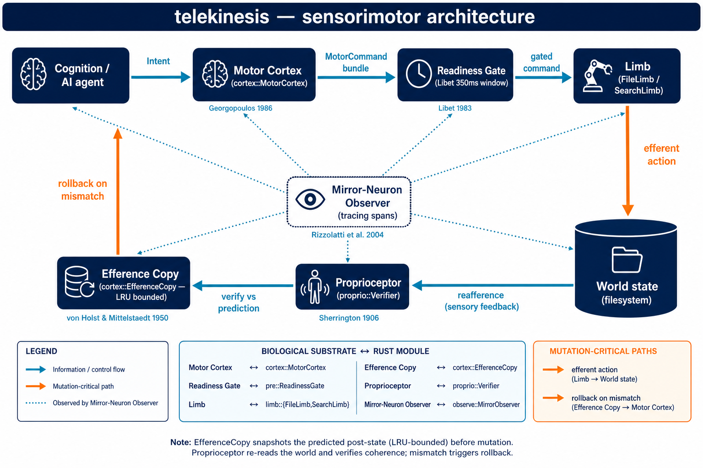

# Telekinesis — a biologically-grounded data-manipulation limb for AI agents

> *"Move data the way a body moves a hand: plan, predict, act, feel, correct."*



`telekinesis` is a Rust crate that gives an AI model (or any program) a first-class **effector** for touching files and data structures. The core abstraction — the `Limb` — is not a metaphor bolted onto CRUD calls; it is a faithful software transliteration of the vertebrate **sensorimotor loop**:

```
   ┌──────────────┐  intent     ┌───────────────┐   command     ┌────────────┐
   │  Cognition   │────────────▶│ Motor Cortex  │──────────────▶│   Limb     │
   │  (the AI)    │             │  (planner)    │               │ (effector) │
   └──────────────┘             └───────┬───────┘               └─────┬──────┘
          ▲                             │efference copy               │
          │                             ▼                             │
          │                     ┌────────────────┐                    │
          │                     │  Predicted     │◀───────────────────┤
          │                     │  outcome       │                    │ reafference
          │  perceived error    │  (rollback)    │                    │ (sensory)
          └─────────────────────┴────────┬───────┘                    │
                                         │                            ▼
                                 ┌───────▼──────┐              ┌───────────────┐
                                 │Proprioceptor │◀─────────────│  World state  │
                                 │  (verifier)  │              │  (filesystem) │
                                 └──────────────┘              └───────────────┘
```

## Why "telekinesis" is the right word

Real motor control is already *action at a distance* — the brain has no direct physical grip on a hand; it fires patterns of neurons and *predicts* what will happen (Georgopoulos 1986, von Holst & Mittelstaedt 1950). For a language model, the "hand" is a filesystem it never physically touches. The cognitive architecture is identical: **plan → predict → act → verify → correct**. Whether or not you believe the parapsychology literature (see disclaimer in `docs/BIOLOGY.md`), the *engineering value* of that architecture is beyond dispute — every safe agentic tool call needs it.

## Quick start

```rust
use telekinesis::prelude::*;

#[tokio::main]
async fn main() -> anyhow::Result<()> {
    let mut nervous_system = NervousSystem::new().await?;

    // Grow a file-search "eye" and a filesystem "hand".
    let eye = nervous_system.grow_limb(SearchLimb::rooted(".")).await;
    let hand = nervous_system.grow_limb(FileLimb::new()).await;

    // Plan: find every TODO in Rust files, ranked by relevance.
    let matches = eye.reach(Intent::Search {
        query: "TODO".into(),
        pattern: Some(r"\.rs$".into()),
        top_k: 20,
    }).await?;

    // Act with efference copy — if the write fails the pre-state is restored.
    for m in matches.into_top() {
        hand.reach(Intent::Annotate {
            path: m.path,
            line: m.line,
            note: "[flagged by telekinesis]".into(),
        }).await?;
    }
    Ok(())
}
```

## CLI demo

```bash
cargo run --release --bin tk -- search "fn main" --path ./src --top 10
cargo run --release --bin tk -- reach --path ./notes.md --op read
```

## Design pillars → biology

| Component            | Rust type              | Biological anchor                                             |
|----------------------|------------------------|---------------------------------------------------------------|
| `Limb` trait         | trait object           | Effector organ (hand, oculomotor system)                      |
| `MotorCortex`        | `cortex::Planner`      | Georgopoulos 1986 — population vector coding                  |
| `EfferenceCopy`      | `cortex::EfferenceCopy`| von Holst & Mittelstaedt 1950 — *Reafferenzprinzip*           |
| `Proprioceptor`      | `proprio::Verifier`    | Sherrington's "sixth sense" — spindles + Golgi tendon organs  |
| `MirrorNeuron`       | `mirror::Observer`     | Rizzolatti et al. — F5 mirror neurons                          |
| Readiness potential  | `cortex::Readiness`    | Libet 1983 — 350ms pre-conscious motor preparation             |
| Actor mesh           | `actor::Nucleus`       | Basal-ganglia-style nuclei, message-passing over channels     |

Details, citations, honest caveats about PK research: see `docs/BIOLOGY.md`.

## License

MIT OR Apache-2.0.
